<!-- ═══════════════════════════════════════════════════════════════════ -->
<!--               ✦  ANIMATED CYBER HEADER BANNER  ✦                  -->
<!-- ═══════════════════════════════════════════════════════════════════ -->

<div align="center">




</div>

<!-- ─── SKILL ICON TICKER ─────────────────────────────────────────────── -->
<div align="center">

</div>

<br/>

<!-- ─── TYPING ANIMATION ──────────────────────────────────────────────── -->
<div align="center">


</div>

<br/>

<!-- ─── BADGE ROW ───────────────────────────────────────────────────────── -->
<div align="center">

[](https://github.com/muktipati)
[](https://www.linkedin.com/in/muktikanta-pati-976385167)
[](https://github.com/muktipati)
[](https://github.com/muktipati?tab=repositories)
[](https://www.linkedin.com/in/muktikanta-pati-976385167)

</div>


---

<!-- ═══════════════════════════════════════════════════════════════════ -->
<!--                   TERMINAL BOOT SEQUENCE                          -->
<!-- ═══════════════════════════════════════════════════════════════════ -->

## ⚡ `profile.load()`

```bash
$ ssh muktikanta@production --role "Senior Software Engineer" --years 9+

Authenticating... ████████████████████  100%  CONNECTED

┌─────────────────────────────────────────────────────────────┐
│  ENGINEER PROFILE — MUKTIKANTA PATI                         │
├──────────────┬──────────────────────────────────────────────┤
│  role        │  Senior Software Engineer · Frontend & UI 🚀 │
│  experience  │  9+ years — enterprise shipped & scaled      │
│  frontend    │  React · TypeScript · Next.js · Redux · ES6+ │
│  backend     │  Node.js · Express · REST APIs · MongoDB     │
│  architecture│  Microfrontends · Shared Component Libraries │
│  quality     │  Jest · Playwright · Automated CI Gates      │
│  devops      │  Docker · Jenkins · Git / GitHub Actions     │
├──────────────┼──────────────────────────────────────────────┤
│  impact      │  ~35% UI load speedup · Reusable Design Sys  │
│              │  Multi-team adoption  · Zero-regression UIs  │
├──────────────┼──────────────────────────────────────────────┤
│  ai focus 🤖 │  LLM workflows · AI-assisted development ·   │
│              │  Developer tooling & automated test gen      │
│  mindset     │  Understand why it works · Make changes easy │
│  seeking     │  Senior / Lead / Staff Roles · Full Ownership│
├──────────────┴──────────────────────────────────────────────┤
│  🟢  ONLINE — Architecting · Building · Mentoring · Shipping│
└─────────────────────────────────────────────────────────────┘

$ █
```

---

<!-- ═══════════════════════════════════════════════════════════════════ -->
<!--                     IMPACT DASHBOARD                              -->
<!-- ═══════════════════════════════════════════════════════════════════ -->

## 📊 Impact Dashboard

<div align="center">

<table>
<tr>
<td align="center" width="220">

<br/><br/>
<sub>Lazy loading · Code splitting · Memoization · Bundle audit</sub>
</td>
<td align="center" width="220">

<br/><br/>
<sub>Shared component libraries · Cross-team adoption · Storybook</sub>
</td>
<td align="center" width="220">

<br/><br/>
<sub>Decoupled domain apps · Independent deploy · Zero friction</sub>
</td>
<td align="center" width="220">

<br/><br/>
<sub>Jest + Playwright · CI quality gates · Zero UI regressions</sub>
</td>
</tr>
</table>

<br/>

<table>
<tr>
<td align="center" width="280">

**⚛️ Frontend Architecture**
<br/>
`Microfrontends` · `Design Systems`
<br/>
`Reusable Libraries` · `State Machines` · `HOCs`

</td>
<td align="center" width="280">

**🔐 Security & Enterprise APIs**
<br/>
`Open-Redirect Defense` · `JWT & RBAC`
<br/>
`RESTful Services` · `MongoDB Indexing`

</td>
<td align="center" width="280">

**🎓 Technical Leadership**
<br/>
`Architecture Reviews` · `Engineering Mentorship`
<br/>
`Developer Experience (DX)` · `Clean Code Standards`

</td>
</tr>
</table>

</div>


---

<!-- ═══════════════════════════════════════════════════════════════════ -->
<!--                    AI × ENGINEERING WORKFLOW                      -->
<!-- ═══════════════════════════════════════════════════════════════════ -->

## 🤖 AI × Engineering Workflows

<div align="center">


<br/><br/>


<br/><br/>

```
        ┌─────────────────────────────────────────────────────────┐
        │                 MUKTIKANTA'S WORKFLOW                   │
        └────────────────────────────┬────────────────────────────┘
                                     │
                                     ▼
        ┌─────────────────────────────────────────────────────────┐
        │             AI-POWERED ACCELERATION LOOP                │
        └──────┬─────────────────────┼─────────────────────┬──────┘
               ▼                     ▼                     ▼
      ┌─────────────────┐   ┌─────────────────┐   ┌─────────────────┐
      │ Rapid Debugging │   │ Automated Tests │   │ Refactor & Perf │
      │  & Root Cause   │   │ Jest/Playwright │   │  Optimization   │
      └────────┬────────┘   └────────┬────────┘   └────────┬────────┘
               └─────────────────────┼─────────────────────┘
                                     ▼
                      High-Confidence Production Ship 🚀
```

</div>


---

<!-- ═══════════════════════════════════════════════════════════════════ -->
<!--                      ENGINEERING PHILOSOPHY                       -->
<!-- ═══════════════════════════════════════════════════════════════════ -->

## 💡 Engineering Philosophy

<div align="center">


</div>

<br/>

<div align="center">

<table>
<tr>
<td width="50%" valign="top">

```
⚡  Performance is a Feature
    Every millisecond counts in enterprise UI.
    Audit renders, trim bundles, optimize state.

🧩  Build Once, Reuse Everywhere
    Components must outlive individual screens.
    Good abstractions compound like interest.

🛡️  Defensive by Design
    Security and validation start at the UI edge.
    Resilient error boundaries prevent cascade failures.
```

</td>
<td width="50%" valign="top">

```
🧪  Code Reviews are Mentorship in Disguise
    A comment that teaches > one that just fixes.
    Elevate the engineer alongside the codebase.

🎯  Make the Next Change Easier
    Write code that is intuitive to read,
    clean to modify, and painless to delete.

🔄  Automate What Doesn't Need a Human
    From linting to CI pipelines and test runs,
    let machines guard repetitive quality.
```

</td>
</tr>
</table>

</div>

---

<!-- ═══════════════════════════════════════════════════════════════════ -->
<!--                          TECH ARSENAL                             -->
<!-- ═══════════════════════════════════════════════════════════════════ -->

## 🛠️ Tech Arsenal

<div align="center">

<table>
<tr><td valign="top" width="50%">

**Frontend & UI Architecture**
<br/>

<br/>
<sub>React 18/19 · TypeScript · Next.js · Microfrontends · Design Systems · Redux Toolkit · Context API · Webpack / Vite</sub>

<br/><br/>

**Backend & Data Services**
<br/>

<br/>
<sub>Node.js · Express.js · RESTful APIs · MongoDB · Mongoose · JWT Authentication · Middleware Architecture</sub>

</td><td valign="top" width="50%">

**Architecture & UI Patterns**
<br/>

<br/>
<sub>Microfrontends · Higher-Order Components (HOC) · Custom Hooks · Compound Components · Render Props · Atomic Design</sub>

<br/><br/>

**Testing, Tooling & DevOps**
<br/>

<br/>
<sub>Jest · React Testing Library · Playwright · Docker · Jenkins · CI/CD Pipelines · SonarQube · Git Workflow</sub>

</td></tr>
</table>

<br/>

<!-- Engineering Specialty callouts -->
<table>
<tr>
<td align="center">

</td>
<td align="center">

</td>
<td align="center">

</td>
</tr>
</table>

</div>

---

<!-- ═══════════════════════════════════════════════════════════════════ -->
<!--                    CAREER & ENGINEERING JOURNEY                   -->
<!-- ═══════════════════════════════════════════════════════════════════ -->

## 💼 Engineering Journey & Evolution


**🟢 Senior Software Engineer & UI Architect** — `9+ Years Production Experience`
> Specializing in high-performance React ecosystems, scalable frontend architecture, and developer productivity

- ⚡ **~35% UI Performance Optimization** — profiling render bottlenecks, lazy loading route chunks, eliminating unneeded re-renders, and implementing virtualized lists
- 🧩 **Enterprise Reusable Component Libraries** — architecting shared UI systems adopted across cross-functional product teams to guarantee visual consistency and slash development cycle times
- 🏗️ **Microfrontend Architecture** — transitioning monolithic frontend codebases into independently deployable micro-apps with unified design tokens and shared state synchronization
- 🔐 **Web Application Security** — auditing frontends against OWASP standards, bulletproofing authentication flows (JWT/RBAC), and sanitizing open-redirect vulnerabilities
- 🧪 **Test Automation & Quality CI** — engineering comprehensive unit & integration test suites using Jest and Playwright with automated GitHub Actions / Jenkins pipelines
- 🤖 **AI-Augmented Engineering** — integrating modern LLM tooling for automated test scaffolding, rapid refactoring, and accelerated problem resolution

---

**🔵 The 9-Year Evolution Path**

```
  Angular / TypeScript  ──►  React & JavaScript  ──►  Node.js & MongoDB  ──►  Microfrontends & Architecture  ──►  AI Engineering
   (Early Foundation)       (Modern Componentry)    (Full-Stack Delivery)       (Enterprise Reusability)           (Modern Era)
```

---

<!-- ═══════════════════════════════════════════════════════════════════ -->
<!--                      SIGNATURE REPOSITORIES                       -->
<!-- ═══════════════════════════════════════════════════════════════════ -->

## 🚀 Signature Repositories Spotlight

<div align="center">

| Repository | Focus & Tech | Architecture Highlights |
|:---|:---|:---|
| 🏗️ **[microfrontend](https://github.com/muktipati/microfrontend)** | JavaScript · React · Module Federation | Independently developed, tested, and deployed UI systems coexisting seamlessly |
| 🧩 **[commoncomponent](https://github.com/muktipati/commoncomponent)** | React · Design Systems · TypeScript | Reusable UI component library designed for cross-project integration |
| 📦 **[shared-react-component-example](https://github.com/muktipati/shared-react-component-example)** | React · Component Architecture | Scalable patterns for packaging and distributing shared component ecosystems |
| ⚡ **[HOC](https://github.com/muktipati/HOC)** | React · Advanced Patterns | Higher-Order Component patterns for cross-cutting concerns and code reuse |
| 🛡️ **[cwe-601-open-redirect-defense-lab](https://github.com/muktipati/cwe-601-open-redirect-defense-lab)** | TypeScript · Web Security | Security research and hands-on defense lab against CWE-601 open redirects |
| 🛒 **[ecommerce](https://github.com/muktipati/ecommerce)** | Node.js · Express · Angular / React | Full-stack e-commerce architecture with RESTful APIs, cart state, and data modeling |
| 🧠 **[javascript_interview](https://github.com/muktipati/javascript_interview)** | Modern JavaScript · Polyfills | Deep dive into JS engines, closures, prototypal inheritance, and event loop mechanics |

<br/>

[](https://github.com/muktipati?tab=repositories)

</div>

---

<!-- ═══════════════════════════════════════════════════════════════════ -->
<!--                        GITHUB STATS                               -->
<!-- ═══════════════════════════════════════════════════════════════════ -->

## 📈 GitHub Stats & Activity

<div align="center">


<br/><br/>


<br/>


</div>

<!-- ─── SNAKE CONTRIBUTION ANIMATION ──────────────────────────────── -->
<div align="center">

<picture>
  <source media="(prefers-color-scheme: dark)" srcset="https://raw.githubusercontent.com/muktipati/Muktipati1111/output/github-contribution-grid-snake-dark.svg"/>
  <source media="(prefers-color-scheme: light)" srcset="https://raw.githubusercontent.com/muktipati/Muktipati1111/output/github-contribution-grid-snake.svg"/>
  
</picture>

</div>

---

<!-- ═══════════════════════════════════════════════════════════════════ -->
<!--                       LEARNING RADAR                              -->
<!-- ═══════════════════════════════════════════════════════════════════ -->

## 🧭 Learning Radar (2026–2027)

<div align="center">


<br/><br/>

<table>
<tr>
<td align="center">🤖<br/><b>AI-Augmented Engineering</b><br/><sub>Hands-on</sub></td>
<td align="center">⚛️<br/><b>Next.js 15+ App Router</b><br/><sub>Building</sub></td>
<td align="center">🏗️<br/><b>Microfrontends & Federation</b><br/><sub>Advanced</sub></td>
<td align="center">⚡<br/><b>Core Web Vitals & Perf</b><br/><sub>Mastery</sub></td>
</tr>
<tr>
<td></td>
<td></td>
<td></td>
<td></td>
</tr>
<tr>
<td align="center">☁️<br/><b>Docker & Containerization</b><br/><sub>Deploying</sub></td>
<td align="center">🧪<br/><b>Playwright E2E Automation</b><br/><sub>Scaling</sub></td>
<td align="center">🛡️<br/><b>OWASP & Web Security</b><br/><sub>Practicing</sub></td>
<td align="center">🔄<br/><b>Distributed System Design</b><br/><sub>Deep Dive</sub></td>
</tr>
<tr>
<td></td>
<td></td>
<td></td>
<td></td>
</tr>
</table>

</div>


---

<!-- ═══════════════════════════════════════════════════════════════════ -->
<!--                        LET'S CONNECT                              -->
<!-- ═══════════════════════════════════════════════════════════════════ -->

## 📬 Let's Connect

<div align="center">

[](https://www.linkedin.com/in/muktikanta-pati-976385167)
[](https://github.com/muktipati)

<br/>

> 💬 *Open to Senior / Lead Frontend and Full Stack engineering roles (Remote, Hybrid, or On-site).*
> *If you're building high-impact web products, modern design systems, or scalable frontend architectures — let's connect!* 🚀

</div>

---

<!-- ═══════════════════════════════════════════════════════════════════ -->
<!--                           FOOTER                                  -->
<!-- ═══════════════════════════════════════════════════════════════════ -->

<div align="center">


<br/>

⭐ *Found something useful in my repositories? A star is always appreciated!*

<br/>


</div>
